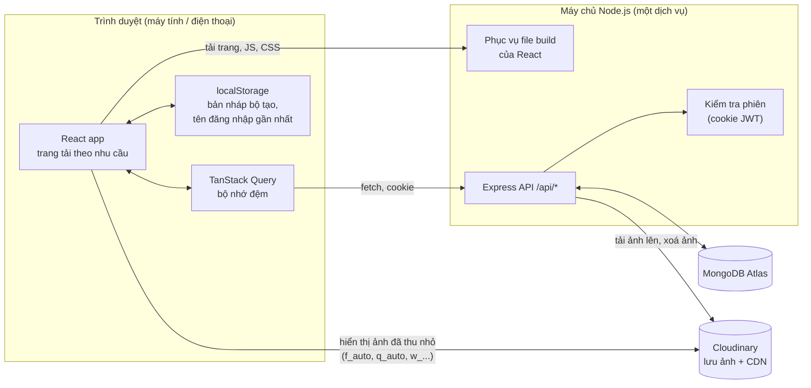
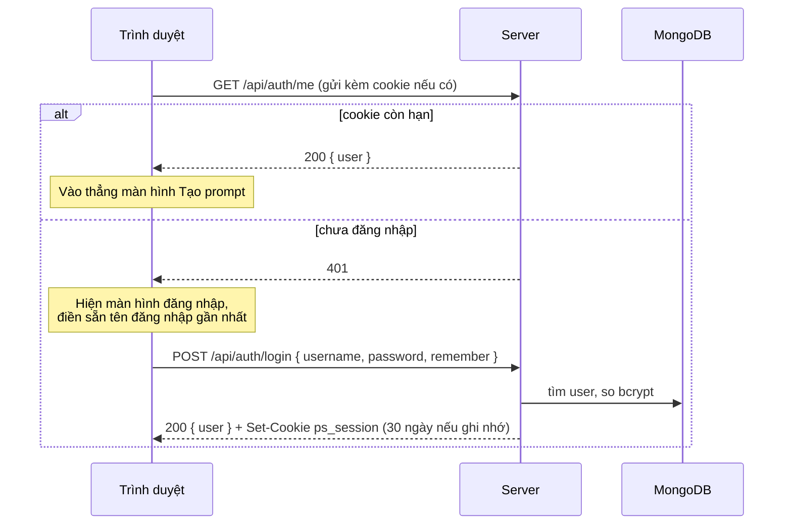
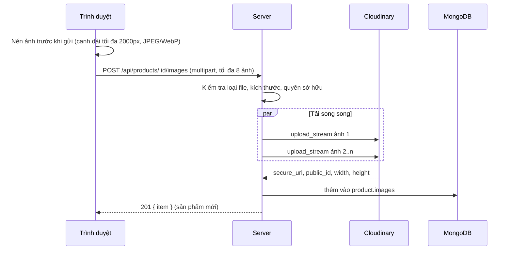

# 02. Kiến trúc hệ thống

## 1. Lựa chọn công nghệ

| Lớp | Công nghệ | Lý do chọn |
|---|---|---|
| Giao diện | **React 18** + **Vite** | Theo yêu cầu. Vite build nhanh, tự tách mã theo `import()` động |
| Điều hướng | **React Router 6** | Hỗ trợ tải trang theo nhu cầu với `React.lazy` |
| Lấy dữ liệu | **TanStack Query 5** | Bộ nhớ đệm, gộp request trùng, tải dần khi cuộn, cập nhật lạc quan; giảm số lần gọi API |
| Kiểu dáng | CSS thuần với biến màu (design tokens) | Không thêm thư viện UI nặng; tự kiểm soát giao diện sáng/tối |
| Máy chủ | **Node.js 20+** + **Express 4** | Theo yêu cầu; nhẹ, quen thuộc |
| Cơ sở dữ liệu | **MongoDB** (Atlas) + **Mongoose 8** | Theo yêu cầu; dữ liệu dạng tài liệu hợp với prompt và lựa chọn của bộ tạo |
| Lưu ảnh | **Cloudinary** | Theo yêu cầu; có CDN và biến đổi ảnh theo URL (thu nhỏ, đổi định dạng) |
| Xác thực | bcrypt + JWT trong cookie httpOnly | Đơn giản, không cần lưu phiên trên máy chủ |
| Kiểm tra dữ liệu | **zod** | Khai báo luật một chỗ, thông báo lỗi tiếng Việt |
| Bảo vệ | helmet, express-rate-limit, compression | Header an toàn, chống dò mật khẩu, nén phản hồi |

## 2. Sơ đồ thành phần



Điểm chính:

- **Một dịch vụ, một địa chỉ.** Express vừa phục vụ API ở `/api`, vừa phục vụ file build của React. Cookie đăng nhập hoạt động tự nhiên, không phải cấu hình CORS.
- **Ảnh đi thẳng từ Cloudinary tới trình duyệt.** Máy chủ chỉ trung chuyển lúc tải ảnh lên. Khi hiển thị, trình duyệt lấy ảnh đã thu nhỏ từ CDN của Cloudinary, không đi qua máy chủ.
- **Ghép prompt chạy hoàn toàn trên trình duyệt.** Prompt cập nhật ngay khi bấm, không cần gọi máy chủ. Máy chủ chỉ lưu kết quả.

## 3. Cấu trúc thư mục

```
prompt-studio/
├─ package.json            # script chung: dev, build, start
├─ render.yaml             # cấu hình deploy Render (tuỳ chọn)
├─ docs/                   # bộ tài liệu này
├─ server/
│  ├─ package.json
│  ├─ .env.example
│  └─ src/
│     ├─ index.js          # khởi động Express, gắn route, phục vụ file build
│     ├─ config.js         # đọc biến môi trường
│     ├─ db.js             # kết nối MongoDB
│     ├─ middleware/auth.js
│     ├─ lib/              # http (lỗi, tiện ích), cloudinary
│     ├─ models/           # User, Product, Prompt, Settings
│     └─ routes/           # auth, products, prompts, settings, transfer
└─ client/
   ├─ package.json
   ├─ vite.config.js       # proxy /api về server khi dev
   ├─ index.html
   └─ src/
      ├─ main.jsx          # router, QueryClient, lazy routes
      ├─ api.js            # hàm gọi API
      ├─ auth.jsx          # ngữ cảnh đăng nhập
      ├─ styles.css        # token màu, chữ, bố cục
      ├─ lib/              # actions.js (76 động tác), prompt.js (ghép prompt), cld.js (URL ảnh)
      ├─ components/       # Layout, LazyImage, ProductPicker, Sequence, PromptPanel, Uploader...
      └─ pages/            # Login, Builder, Products, ProductDetail, Prompts, Library, Settings
```

## 4. Các luồng chính

### 4.1 Đăng nhập và tự vào lại



### 4.2 Tải ảnh sản phẩm



Ảnh được **nén ngay trên trình duyệt** trước khi gửi. Ảnh điện thoại 5 đến 10 MB thường còn khoảng 300 đến 600 KB, nên tải lên nhanh hơn nhiều trên mạng di động và tiết kiệm dung lượng Cloudinary.

### 4.3 Lưu prompt tốt

1. Bộ tạo ghép prompt trên trình duyệt.
2. Người dùng bấm **Lưu prompt tốt**, chọn sản phẩm có sẵn hoặc gõ tên mới.
3. `POST /api/prompts` gửi nguyên văn prompt, negative, ghi chú, công cụ và **ảnh chụp lựa chọn** (`settings`).
4. Máy chủ tạo prompt, tăng `promptCount` và cập nhật `lastPromptAt` của sản phẩm.
5. Giao diện cập nhật bộ nhớ đệm, không phải tải lại danh sách.

## 5. Chiến lược hiệu năng

| Kỹ thuật | Áp dụng ở đâu | Tác dụng |
|---|---|---|
| Tách mã theo trang | `React.lazy(() => import("./pages/..."))` cho mọi trang trừ khung chính | Lần mở đầu chỉ tải khung app và trang đang xem |
| Tải trước khi rê chuột | Rê chuột hoặc chạm vào mục menu thì bắt đầu tải mã của trang đó | Bấm vào là trang hiện gần như ngay |
| Ảnh thu nhỏ theo URL | `.../upload/f_auto,q_auto,w_320,c_limit/...` | Ảnh lưới chỉ vài chục KB; tự chọn WebP/AVIF |
| `srcset` theo mật độ điểm ảnh | Ảnh 1x và 2x | Nét trên màn hình Retina mà không tải thừa |
| Ảnh mờ giữ chỗ | `w_24,e_blur:200` làm nền trước khi ảnh thật tải xong | Không có ô trắng, cảm giác nhanh |
| `loading="lazy"`, `decoding="async"` | Mọi ảnh ngoài màn hình đầu | Không tải ảnh người dùng chưa cuộn tới |
| Khung ảnh giữ tỉ lệ | `aspect-ratio` trên khung | Không giật bố cục |
| Tải dần khi cuộn | Danh sách prompt dùng `IntersectionObserver` và con trỏ `_id` | Mỗi lần 20 mục, truy vấn nhanh kể cả khi có hàng nghìn prompt |
| Bộ nhớ đệm phía client | TanStack Query, `staleTime` 30 giây | Quay lại trang cũ không phải chờ |
| Cập nhật lạc quan | Xoá prompt, đổi ảnh đại diện | Giao diện đổi ngay, gọi API chạy nền |
| Truy vấn gọn | `.lean()`, `.select()` chỉ các trường cần | Phản hồi nhỏ, nhanh |
| Chỉ mục MongoDB | Xem tài liệu 03 | Mọi danh sách đi qua chỉ mục |
| Nén và cache tĩnh | `compression`; file trong `/assets` cache 1 năm | Tải lại trang gần như tức thì |
| Ghép prompt tại chỗ | Hàm thuần trong `lib/prompt.js`, dùng `useMemo` | Không trễ khi bấm chọn |

## 6. Chiến lược bảo mật

| Rủi ro | Biện pháp |
|---|---|
| Lộ mật khẩu | bcrypt (cost 10); không log mật khẩu; thông báo lỗi chung "Sai tên đăng nhập hoặc mật khẩu" |
| Dò mật khẩu | Tối đa 30 lần mỗi 15 phút cho mỗi địa chỉ IP trên route đăng nhập và đăng ký |
| Đánh cắp phiên qua JavaScript | Cookie `httpOnly`; không lưu token trong localStorage |
| Giả mạo request từ trang khác (CSRF) | Cookie `SameSite=Lax`; API chỉ nhận JSON hoặc multipart từ cùng nguồn |
| Đọc dữ liệu người khác | Mọi truy vấn có điều kiện `owner = userId` |
| Tải file độc | Chỉ nhận ảnh, tối đa 10 MB mỗi file, 8 file mỗi lần; Cloudinary xử lý lại ảnh |
| Lộ khoá bí mật | Biến môi trường; file `.env` nằm trong `.gitignore` |
| Header không an toàn | `helmet` với Content-Security-Policy cho phép ảnh từ `res.cloudinary.com` và font từ Google Fonts |

## 7. Xử lý lỗi

- Máy chủ trả lỗi dạng `{ "error": "Câu tiếng Việt nói rõ chuyện gì và cách sửa" }`.
- Lỗi 5xx không lộ chi tiết kỹ thuật ra ngoài, chỉ ghi log ở máy chủ.
- Giao diện:
  - Lỗi 401 bất kỳ: xoá dữ liệu đệm và đưa về màn hình đăng nhập.
  - Mất mạng: hiện thông báo và nút "Thử lại".
  - Máy chủ đang thức dậy (lần đầu mở sau một lúc): màn hình chờ ghi rõ "Máy chủ đang khởi động, chờ khoảng 1 phút".
