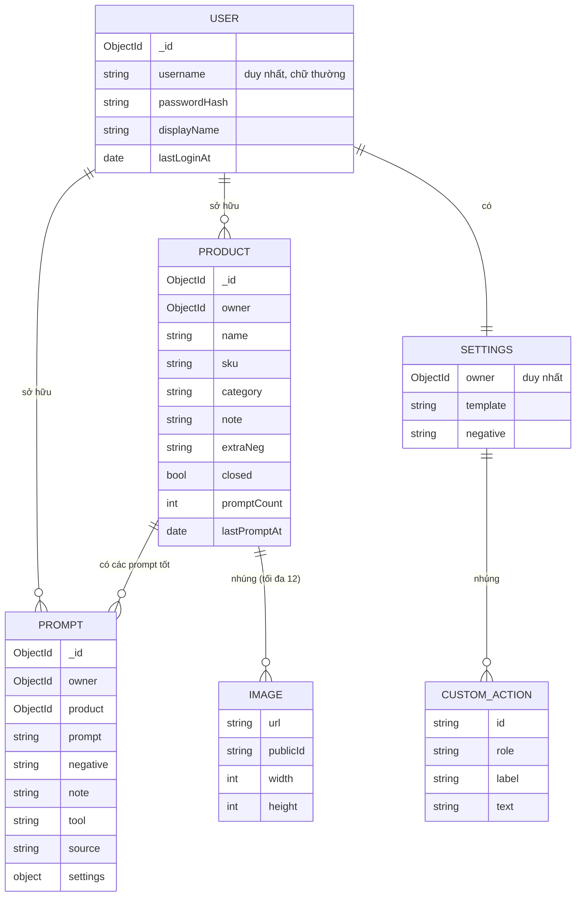

# 03. Thiết kế cơ sở dữ liệu (MongoDB)

## 1. Sơ đồ quan hệ



Mọi collection có `createdAt` và `updatedAt` tự động (`timestamps: true`).

## 2. Chi tiết từng collection

### 2.1 `users`

| Trường | Kiểu | Ràng buộc | Ghi chú |
|---|---|---|---|
| `username` | string | bắt buộc, duy nhất, 3–30 ký tự, `[a-z0-9_.]` | Lưu chữ thường; đăng nhập không phân biệt hoa thường |
| `passwordHash` | string | bắt buộc | bcrypt |
| `displayName` | string | tuỳ chọn | Mặc định hiển thị `username` |
| `lastLoginAt` | date | | Cập nhật mỗi lần đăng nhập |

**Chỉ mục:** `{ username: 1 }` duy nhất.

### 2.2 `products`

Sản phẩm **dùng chung cho cả nhóm**: thành viên nào cũng xem, sửa, xoá được. `owner` chỉ ghi lại người tạo.

| Trường | Kiểu | Ràng buộc | Ghi chú |
|---|---|---|---|
| `owner` | ObjectId → users | bắt buộc | Người tạo, không dùng để giới hạn quyền |
| `name` | string | bắt buộc, tối đa 160 | Ví dụ "Nón chống nắng vành rộng" |
| `sku` | string | tối đa 60 | Mã sản phẩm tuỳ chọn |
| `category` | string | tối đa 60, mặc định `""` | Loại sản phẩm gõ tự do ("Áo", "Nón"...), dùng để lọc prompt đã lưu |
| `note` | string | tối đa 2000 | Ghi chú tự do |
| `extraNeg` | string | tối đa 1000 | Lỗi riêng cần chặn, cách nhau bằng dấu phẩy |
| `closed` | bool | mặc định `true` | "Áo luôn đóng, không mở" |
| `images` | mảng `Image` | tối đa 12 | Phần tử đầu tiên là ảnh đại diện |
| `promptCount` | number | mặc định 0 | Đếm sẵn để hiện trên thẻ sản phẩm, khỏi đếm lại |
| `lastPromptAt` | date | | Lần lưu prompt gần nhất |

`Image` (nhúng, không có `_id`): `url` (https của Cloudinary), `publicId` (để xoá), `width`, `height` (để giữ tỉ lệ khung trước khi ảnh tải).

**Chỉ mục:**

| Chỉ mục | Phục vụ truy vấn |
|---|---|
| `{ updatedAt: -1 }` | Danh sách sản phẩm mới cập nhật lên trước |
| `{ name: 1 }` | Tìm theo tên, tìm hoặc tạo sản phẩm khi lưu prompt |

**Vì sao ảnh nhúng trong sản phẩm:** ảnh luôn được đọc cùng sản phẩm, số lượng ít (tối đa 12), không bao giờ truy vấn ảnh riêng lẻ. Nhúng giúp một lần đọc là đủ.

### 2.3 `prompts`

| Trường | Kiểu | Ràng buộc | Ghi chú |
|---|---|---|---|
| `owner` | ObjectId → users | bắt buộc | |
| `product` | ObjectId → products | bắt buộc | |
| `prompt` | string | bắt buộc, tối đa 20000 | Nguyên văn, không đổi khi sau này sửa template |
| `negative` | string | tối đa 5000 | |
| `note` | string | tối đa 1000 | "Ra đẹp lần đầu, tay không lỗi" |
| `tool` | string | tối đa 60 | "Meta AI", "Dola AI"... |
| `source` | string | `builder` hoặc `external`, mặc định `builder` | `external`: prompt dán từ ngoài, không có `settings` nên không "Dùng lại và chỉnh" được, nhưng sửa được nội dung |
| `settings` | object | | Ảnh chụp lựa chọn của bộ tạo, xem mục 3. Rỗng khi `source = external` |

**Chỉ mục:**

| Chỉ mục | Phục vụ truy vấn |
|---|---|
| `{ owner: 1, _id: -1 }` | Tất cả prompt, mới nhất trước, phân trang bằng con trỏ `_id` |
| `{ owner: 1, product: 1, _id: -1 }` | Prompt của một sản phẩm |
| `{ product: 1, _id: -1 }` | Danh sách chung của cả nhóm, lọc theo sản phẩm hoặc loại sản phẩm |
| `{ createdAt: -1 }` | Lọc theo thời gian lưu |

**Vì sao prompt là collection riêng:** số lượng tăng không giới hạn theo thời gian và cần phân trang. Nhúng vào sản phẩm sẽ làm tài liệu sản phẩm phình to.

### 2.4 `videoplans`

Kế hoạch làm video, mỗi tài liệu là một dòng "sản phẩm × người thực hiện". Xem [tài liệu 09](09-ke-hoach-video.md).

| Trường | Kiểu | Ràng buộc | Ghi chú |
|---|---|---|---|
| `product` | ObjectId → products | bắt buộc | Xoá sản phẩm thì xoá luôn kế hoạch |
| `target` | int | 1–999 | Chỉ còn ở kế hoạch cũ; kế hoạch mới luôn là 1 (một kế hoạch = một video) |
| `assignee` | ObjectId → users | bắt buộc | Người thực hiện |
| `status` | string | `todo`, `partial`, `done` | Chưa thực hiện, Còn thiếu, Đã hoàn thành. Người thực hiện tự chọn, app không tự đếm |
| `done` | int | 0–999 | Chỉ còn ở kế hoạch cũ; tự chỉnh theo trạng thái |
| `dueDate` | string | `"YYYY-MM-DD"` hoặc `""` | Ngày theo lịch, không lệch múi giờ |
| `day` | string | `"YYYY-MM-DD"` | Ngày tạo theo giờ Việt Nam, đặt tên thư mục ngày trên Drive |
| `note` | string | tối đa 1000 | |
| `folder` | `{ id, name }` | | Thư mục của kế hoạch trên Drive; rỗng khi chưa tạo được |
| `files.clip1`, `files.clip2`, `files.audio`, `files.final` | `{ id, name, size, mimeType, by, at }` | không bắt buộc | File Drive của từng mục: 2 video 10 giây, mp3 lời đọc, video thành phẩm |
| `voiceText` | string | tối đa 5000 | Text lời đọc |
| `caption` | string | tối đa 5000 | Mô tả khi đăng |
| `createdBy` | ObjectId → users | bắt buộc | Người lập kế hoạch |
| `createdAt`, `updatedAt` | date | tự động | |

**Chỉ mục:** `{ assignee: 1, status: 1, dueDate: 1 }` cho "việc của tôi chưa xong"; `{ product: 1 }` cho lọc theo sản phẩm và xoá theo sản phẩm.

### 2.5 `settings`

Mỗi người dùng một tài liệu, tạo khi lần đầu lưu cài đặt.

| Trường | Kiểu | Ghi chú |
|---|---|---|
| `owner` | ObjectId → users, duy nhất | |
| `template` | string | Rỗng nghĩa là dùng template mặc định của app |
| `negative` | string | Rỗng nghĩa là dùng negative mặc định |
| `customActions` | mảng `{ id, role, label, text }` | Động tác riêng; `role` là `open`, `mid` hoặc `end` |

Để rỗng thay vì chép template mặc định vào cơ sở dữ liệu: khi app cập nhật template mặc định, những người chưa tự sửa sẽ nhận bản mới ngay.

## 3. Cấu trúc `settings` trong một prompt

Đây là toàn bộ lựa chọn của bộ tạo tại lúc lưu. Dùng cho chức năng "Dùng lại và chỉnh".

```json
{
  "gender": "f",
  "dur": 15,
  "style": "bold",
  "open": "ob1",
  "mid": ["mb1", "mb2", "p1", "t8"],
  "end": "eb1",
  "endOn": false,
  "closed": true,
  "cont": false,
  "audio": "none",
  "extraNeg": "shrinking brim, missing drawstring"
}
```

| Khoá | Giá trị |
|---|---|
| `gender` | `f` nữ, `m` nam |
| `dur` | 10, 15, 20 (giây) |
| `style` | `bold` nổi bật, `soft` nhẹ nhàng (chỉ ảnh hưởng nút Đổi ngẫu nhiên) |
| `open`, `end` | Mã động tác mở đầu và kết |
| `mid` | Danh sách mã động tác đoạn giữa theo thứ tự |
| `endOn` | Có đoạn kết hay không |
| `closed` | Áo luôn đóng |
| `cont` | Nối từ khung cuối clip trước |
| `audio` | `none` hoặc `amb` |
| `extraNeg` | Lỗi riêng cần chặn tại lúc lưu |

Mã động tác có sẵn (`ob1`, `mb2`...) cố định trong mã nguồn. Động tác riêng có mã dạng `c...`. Nếu một mã không còn tồn tại (động tác riêng đã xoá), bộ tạo tự thay bằng động tác mặc định của vị trí đó.

## 4. Ví dụ tài liệu

```json
// products
{
  "_id": "671a0c...",
  "owner": "6719ff...",
  "name": "Nón chống nắng vành rộng",
  "sku": "N12",
  "extraNeg": "shrinking brim, missing face covering, missing drawstring",
  "closed": true,
  "images": [
    { "url": "https://res.cloudinary.com/demo/image/upload/v1729/prompt-studio/6719ff/671a0c/abc.jpg",
      "publicId": "prompt-studio/6719ff/671a0c/abc", "width": 1500, "height": 2000 }
  ],
  "promptCount": 3,
  "lastPromptAt": "2026-10-20T05:10:00Z"
}
```

## 5. Ước lượng dung lượng

| Đối tượng | Kích thước trung bình | 1.000 mục |
|---|---|---|
| Prompt (khoảng 3.500 ký tự + negative + settings) | ~5 KB | ~5 MB |
| Sản phẩm (không tính ảnh, ảnh nằm ở Cloudinary) | ~1 KB | ~1 MB |

Gói MongoDB Atlas miễn phí có 512 MB, đủ cho khoảng 80.000 prompt. Ảnh không chiếm dung lượng MongoDB.

## 6. Thư mục ảnh trên Cloudinary

```
prompt-studio/<userId>/<productId>/<tên ngẫu nhiên>
```

Xoá sản phẩm thì xoá từng ảnh theo `publicId`. Xoá ảnh thất bại (ví dụ Cloudinary tạm lỗi) không chặn việc xoá sản phẩm. Ảnh mồ côi còn sót lại có thể dọn tay theo thư mục.
